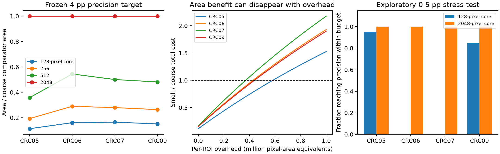

# Acquisition geometry at valid precision

## Direction selection

The selected research question is: **Which acquisition scale minimizes actual
measurement cost for a specified spatial-readout precision, and when can changing
the scale help?** This is independent of Extrusion Net. The earlier direct-pair
prediction result remains negative; these acquisition results do not rescue it.

Three initial screens used only existing development panels:

| Direction | Result | Decision |
|---|---|---|
| Recover extra relationships from overlapping coarse ROIs | At eight tiles, only 0.035%, 0.449% and 0.015% extra pairs on CRC02, CRC11 and CRC19 | Drop as main route on this sparse frame |
| Change the statistical/physical measurement scale | Valid pair-scale binomial intervals were far narrower; fair PPS comparisons across core scales favored small cores in area | Continue with independent patients |
| Characterize measurement limits | Realizable marker assignments hidden in one deep core remain indistinguishable with probability 1-m/K | Retain as a limitation, not a new theorem |

The low overlap is a property of this selected frame, not evidence that overlap
never matters. Direct random-pair sampling is a classical baseline. The selected
follow-up measures every owned pair in each region rather than discarding most
of its available information.

## Frozen confirmation

The estimator, stopping rule, selected core and protocol were committed at
`fef5b518b01067cec11875ef422f24f8f439288b` before downloading new marker tables.
Four distinct additional patients were CRC05, CRC06, CRC07 and CRC09. CRC08 was
not confused with the P37_S37 section; the source patient mapping was checked.

All scales use the same classical PPS sampler and bounded-mean betting confidence
sequence, intersected with deterministic bounds from measured owned totals.
Sampling a region with probability proportional to its known pair count makes
its measured positive-pair fraction an unbiased [0,1] observation of the target.
The confidence law remains valid at the stopping time under its stated fixed-graph,
exact-label assumptions. This is not an iid-cell assumption.

Primary target was absolute interval width <=0.04, inspected at the fixed draw
checkpoints, with a maximum of 2048 draws. There were 100 acquisition trials per patient
per scale. All 400 selected-small-core acquisitions stopped at 256 draws and
covered the target in this simulation. The mathematical guarantee is at least
95% simultaneous coverage over time; observing 100% here does not strengthen it.

| Patient | True pair rate | Small-core mean interval width | Small/coarse union area | Small/coarse distinct ROIs |
|---|---:|---:|---:|---:|
| CRC05 | 0.571% | 3.222 pp | 0.113 | 225.8 / 27.0 |
| CRC06 | 1.780% | 3.500 pp | 0.161 | 247.2 / 23.8 |
| CRC07 | 1.094% | 3.356 pp | 0.165 | 233.1 / 19.7 |
| CRC09 | 0.512% | 3.196 pp | 0.151 | 237.3 / 22.8 |

The frozen primary criterion passed on all four patients: >=95% attainment and
less mean union area for each. These new panels contain 179226, 1000629, 526193
and 379962 directed pairs respectively. Neither pairs nor acquisition repetitions
are independent patient replicates.

## Why this is not a universal small-region win

A four-percentage-point width is broad relative to these low marker-pair rates.
Exploratory tighter-precision stress tests therefore followed confirmation. They
use the same patients and are **not** independent confirmation of a new choice.
Twenty acquisitions per condition were used.

| Patient | Small-core attainment at 1 pp | Small-core attainment at 0.5 pp | Coarse attainment at 0.5 pp |
|---|---:|---:|---:|
| CRC05 | 100% | 95% | 100% |
| CRC06 | 100% | 0% | 100% |
| CRC07 | 100% | 0% | 100% |
| CRC09 | 100% | 85% | 100% |

Small cores retained an area advantage at the 1 pp target but needed hundreds
to over a thousand regions. At 0.5 pp, failed small-core acquisitions must not
be compared to successful coarse acquisitions as equal-precision savings.
The coarse frame can approach a complete census and exploit exact completion
bounds. Fine frames have many more units and can hit the draw limit first.

Area alone also omits instrument overhead. For C = union area + h * distinct ROIs,
the 4 pp confirmation break-even h values are about 582261, 427207, 370157 and
438771 native-pixel area equivalents per ROI for the four patients. Above those
values the coarse comparator is cheaper. These are sensitivity values, not
instrument prices. Summed rectangle area is also retained, charging repeated
overlap between different ROIs; assuming union-area acquisition can avoid repeated
imaging is optimistic. The experiment fixes the checkpoint schedule for all scales.

## Observation validity and the lower bound

Each core has an 80-pixel halo. All source cells in the halos are retained, all
stored edges satisfy the radius, and 100 neighborhoods per new patient are
independently checked against the complete source table. Tables are range-fetched
from pinned archive members with ZIP CRC/length validation and SHA256 hashes.
The graph is derived from source fluorescence segmentation. No H&E-only detector,
cell-matching error or acquisition hardware has been validated here.

The lower-bound construction changes marker calls only in a deep interior core
that no other coarse ROI can observe. Compare all-zero labels with both marker
calls positive in that deep core. If the readout separation is delta and m of K
coarse regions are sampled uniformly, the experiments are identical with
probability 1-m/K. The classical two-point argument gives minimax MSE at least
delta^2(1-m/K)/4. An interval always shorter than delta cannot have worst-case
coverage exceeding 1-(1-m/K)/2 on these two populations. At eight of 32 tiles,
that upper bound is 62.5%. This is a synthetic adversarial assignment on real
geometry, not an assertion about biological coexpression or the observed labels.

## Research payoff and novelty boundary

The payoff is a validated reason to study geometry and precision jointly: the
preferred scale changes with precision, ROI overhead and the available census.
The current methods are classical; this is a useful acquisition benchmark, not
a 9/10 algorithmic contribution.

A higher-upside target is a geometry-adaptive acquisition policy with a bound on
its excess cost relative to the best allowed measurement design, while preserving
valid uncertainty when prediction maps are unreliable. Choosing the next scale
from past observations is compatible with the betting argument if every next
PPS draw still has the same conditional mean. Merely mixing scales is therefore
not the novel theorem. The unresolved part is efficient, near-optimal physical
measurement selection and a matching information/cost limit for the actual
joint observation graph.

Existing [active inference](https://proceedings.mlr.press/v235/zrnic24a.html),
[spatial design-based PPI](https://arxiv.org/abs/2608.10356),
[graph sampling](https://eprints.soton.ac.uk/415590/),
[optimal motif sampling](https://proceedings.mlr.press/v75/klusowski18a.html),
[sampling-aware multiplexed imaging](https://arxiv.org/abs/2604.07890), and
[stochastic Boolean evaluation](https://arxiv.org/abs/1303.0726) constrain any
priority claim. A real acquisition cost model, geometry available before marker
measurement, comparison to strong adaptive policies, and another independent
cohort are required before advancing the broader claim.

Reproduce screens with `python screen_acquisition.py` and
`python study_region_scale.py --repetitions 20`. The frozen confirmation runs with
`python confirm_region_scale.py`; raw tables are cached under ignored data/.
All repetitions and stopping intervals are in results/region_scale_confirmation.json.
The post-confirmation stress analysis is explicitly labeled in
results/region_scale_precision_stress.json. Reproduce that stress test with
`python study_region_scale.py --precision-stress --repetitions 20`. The realizable
lower-bound construction runs with `python study_hotspot_bound.py`. Run all invariants with
`python -m unittest discover -s tests -v`.
Render the figure with `python plot_acquisition_geometry.py`.

## Stronger follow-up

[Residual sampling and cell-level reuse](RESIDUAL_ACQUISITION_RESULTS.md) remove
repeated acquisitions and reuse more observed information. A separate
[0.5-point confirmation](CELL_REUSE_CONFIRMATION_RESULTS.md) passed on four new
patients, with an explicit limitation: summed rectangle cost favors coarse
acquisition on three patients. These results do not replace the failures above.
