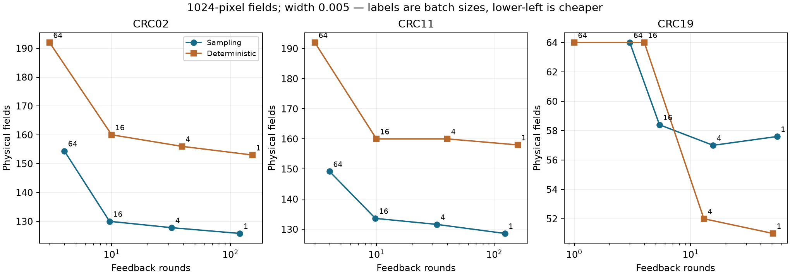

# Certify a spatial readout at the cost of physical measurement

**Measurements can be acquired in batches while retaining a 95% simultaneous
confidence guarantee at completed batch boundaries.** The guarantee conditions
on a fixed source cell graph and exact observed marker calls. It requires no
independence assumption between biological cells. Physical-field reuse and
logical zero-edge deductions carry across batches.

This moves the project toward a concrete question: **which measurements are
needed to certify a spatial claim, once field exposure and feedback latency
both cost time?** A convincing answer requires instrument costs. This screen
establishes a useful cost tradeoff, not measured instrument savings.

## Why batching is valid

Let M be the number of target directed edges, K the number of known positive
edges, and U the number of unresolved edges before a batch. Partition unresolved
edges into groups with counts m_g and positive counts Y_g. Draw b group indices
independently with replacement, with probabilities m_g/U, before seeing any new
labels. For each draw retain

`Z = K/M + (U/M) (Y_g/m_g)`.

Conditional on the pre-batch history and the fixed finite population, the b
values are independent draws with mean T, the target positive-pair fraction,
and bounds `[K/M, (K+U)/M]`. Random draw indices may coincide. Their repeated
values must still count as repeated randomized observations, although a camera
field is only acquired once.

For a candidate mean mu, the existing capped bets produce nonnegative factors
`1 + lambda(Z-mu)` (and the reverse-sign version), with lambda/support frozen
at the pre-batch state. At mu=T the product over the entire batch has conditional
mean one. Multiplying across batches and mixing fixed base bet sizes retains a
nonnegative martingale at batch boundaries. Ville's inequality with threshold
2/alpha for each sign gives the two-sided confidence sequence. Intersecting it
with the sharp deterministic current-data bounds preserves coverage.

The implementation freezes every query's unresolved subset before acquisition,
constructs all b values using the old K and U, and updates the shared cache only
afterward. It checks the interval after complete batches. Recomputing query
denominators after revealing part of the batch is a different, unjustified
procedure. This construction uses established betting methods; it is not a
claim to have invented confidence sequences or batch testing.

## Development results

[Protocol and chronological amendments](BATCH_ACQUISITION_PROTOCOL.md),
[code](study_batch_acquisition.py), [all results](results/batch_acquisition_study.json).

Three development patients, three hypothetical camera fields (512/1024/2048
native pixels), batches 1/4/16/64, five randomized repeats: 180 sampling paths.
All 180 attained width .005 within 2048 draws; 179/180 covered truth at every
inspected boundary. The one failure was CRC02, field 512, batch 4, repeat 0,
with two uncovered intermediate checkpoints. It is retained; the empirical
result is not a claim of 100% coverage. No empty sets were observed. These
repeat counts are not independent patients.

Compared with one query per feedback round, batch 16 substantially reduced
feedback rounds while increasing physical exposure. At field size 1024:

| Patient | Batch 1: fields / rounds | Batch 16: fields / rounds | Batch 64: fields / rounds |
|---|---:|---:|---:|
| CRC02 | 125.8 / 120.0 | 130.0 / 9.6 | 154.4 / 4.0 |
| CRC11 | 128.6 / 123.0 | 133.6 / 9.8 | 149.2 / 4.0 |
| CRC19 | 57.6 / 55.4 | 58.4 / 5.4 | 64.0 / 3.0 |

Thus at this field size batch 16 reduces feedback rounds by 90.3%-92.0% at
1.4%-3.9% additional field exposures. Every method here, including batch 1,
checks after each completed batch; the earlier raster study used sparse
checkpoints. Its field counts must not be used as the matched baseline here.

## The control that changes the conclusion

A deterministic graph control selects the unobserved fields incident to the
most unresolved edges and stops when `[K/M,(K+U)/M]` is narrow enough. These
bounds are sharp for unrestricted unobserved binary marker bits. Selection uses
only geometry and previously observed labels. It has no probabilistic error
budget under the fixed-graph/exact-label assumptions.

After the initial comparison, this control was also allowed batches 1/4/16/64;
otherwise the latency comparison would unfairly force it to operate sequentially.
All 36 deterministic runs completed and covered truth.

With cost `C = fields + h * feedback_rounds`, where h is measured in units of
one field exposure, the winning policy family over the tested batch sizes is:

| Patient | Field side | h=0 | h=1 | h=10 | h=100 |
|---|---:|---|---|---|---|
| CRC02 | 512 | Sampling | Sampling | Sampling | Sampling |
| CRC02 | 1024 | Sampling | Sampling | Sampling | Deterministic |
| CRC02 | 2048 | Deterministic | Sampling | Deterministic | Deterministic |
| CRC11 | 512 | Sampling | Sampling | Sampling | Sampling |
| CRC11 | 1024 | Sampling | Sampling | Sampling | Deterministic |
| CRC11 | 2048 | Sampling | Deterministic | Deterministic | Deterministic |
| CRC19 | 512 | Sampling | Sampling | Deterministic | Deterministic |
| CRC19 | 1024 | Deterministic | Sampling | Deterministic | Deterministic |
| CRC19 | 2048 | Deterministic | Sampling | Sampling | Deterministic |

These are retrospective development means, not an implementable policy that
knows the best method for a new patient. The deterministic method wins 7/9
settings at h=100. A universal superiority claim for the sampler is rejected.
An actual selector must be frozen using development data and tested on untouched
patients; it cannot select the best result after inspecting the new patient's truth.

## Selected direction and pivot rule

Continue **cost-aware certification of spatial readouts**, with statistical and
deterministic certificates as competing tools. Stop treating small ROIs, more
adaptation or a newly named sampler as the contribution. At high feedback cost,
measuring a large batch and using exact bounds can be the right answer.

The next substantial contribution would be a policy and a bound on measurement
cost for **multiple spatial claims sharing the same measured cells**. For
example, an unobserved marker can participate in thousands of pairs, several
regions, and several distance bands; one measured negative can eliminate many
candidate positive pairs. This couples the unresolved claims and physical
measurement costs. It is a research target, not a theorem already proved here.

Test it against independent per-claim acquisition, batched greedy certificates,
uniform field sampling and full acquisition. Include simultaneous error control,
prediction failures, imperfect marker calls and a second cohort. Freeze the
acquisition policy and patient-level endpoints before using new patients.
If shared acquisition gives no meaningful cost advantage, retain this study as
a strong audit and pivot to characterizing when virtual spatial claims can be
falsified with a limited measurement budget.

For a virtual prediction t_hat, an interval [L,U] for the measured target can
certify `|T-t_hat| <= epsilon` only when `[L,U]` lies entirely inside
`[t_hat-epsilon,t_hat+epsilon]`. A narrow interval alone does not establish that
the prediction is accurate. Certification of that statement has not yet been
tested against Strand's predictions, and no proprietary model was evaluated.

## Originality and practical boundaries

[Sequential batch testing](https://optimization-online.org/wp-content/uploads/2024/06/sequential_batch_testing.pdf)
already studies setup-cost tradeoffs and early stopping, including AND and
threshold functions. Its component-probability setting is distinct from the
fixed dependent graph here, but batching itself is not novel. Likewise,
[graph sampling](https://doi.org/10.1007/s40300-017-0126-y) and
[betting inference](https://arxiv.org/abs/2006.04347) are established.
The possible contribution is the coupled spatial-certification problem and its
cost/accuracy guarantees, not renaming those ingredients.

Actual field dimensions, random-access control, caching, movement and feedback
latency are unverified. The source graph comes from fluorescence segmentation;
the selected sparse panels can favor fine acquisition over coarse fields that
extend outside them. Staining, prescan and segmentation costs are excluded.
The alpha=.05 guarantee treats marker calls as exact and concerns this fixed
pair-fraction target, not biological function, diagnosis or treatment benefit.

Reproduce: `python study_batch_acquisition.py`, `python plot_batch_acquisition.py`,
`python -m unittest discover -s tests -v`.
