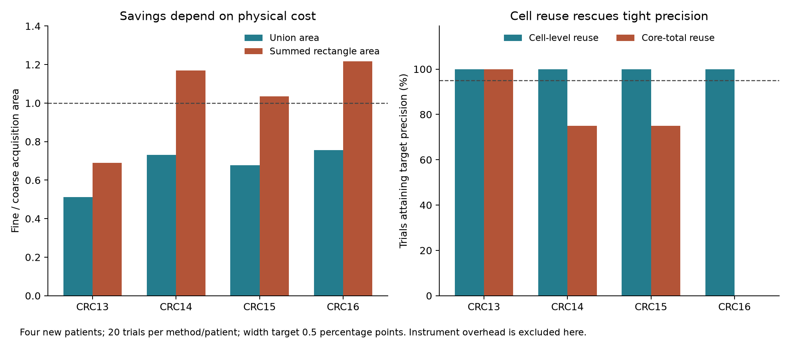

# Tight-precision confirmation with physical observation reuse

The frozen primary criterion passed on all four new patients, conditional on the
union-area cost model. Fixed fine-core cell reuse reached a 0.5-percentage-point
interval in every run and used less union area than the stronger coarse cell-reuse
comparator. This does **not** establish lower instrument cost: acquisition counts
are much larger, and summed rectangle area favors coarse acquisition on three
patients.

## Freeze and data

Protocol and implementation commit `cf5410458aeaf6a846f0d48e0284eb7ff3dbd1f8` was
pushed before the four marker-table downloads. This is a timestamped repository
protocol, not external preregistration. CRC13–CRC16 map to sections S45–S48 in the
authors' object names. The tables were fetched using verified ZIP byte ranges,
CRC32 and length checks, and recorded SHA-256 hashes. No entire image archive was
downloaded. Panels were selected from coordinates before reading marker outcomes
for selection. One hundred neighborhoods per patient were checked against the
complete source table.

The new panels contain 63,834, 83,170, 84,472 and 104,165 cells, respectively, and
988,629, 1,644,422, 1,549,696 and 2,030,891 directed pairs. These are four patients
from the same ORION cohort, not an independent cohort or millions of independent
biological replicates. The graph still comes from source fluorescence processing.

## Frozen comparison

All methods use the same fixed pair target, residual PPS sampling, and predictable
bounded betting with alpha .05. The target width is .005, with at most 2048
acquisitions. There are 20 randomizations per patient/method. The primary comparison
uses full cell visibility and negative-marker deductions at both scales. A
fine-core-only reuse ablation tests the contribution of the new observation logic.

| Patient | Fine / coarse union area | Fine / coarse acquisitions | Fine / coarse precision attainment | Core-only fine attainment |
|---|---:|---:|---:|---:|
| CRC13 | 62.41M / 122.01M | 1024 / 25.25 | 100% / 100% | 100% |
| CRC14 | 99.54M / 136.34M | 1927.3 / 28.05 | 100% / 100% | 75% |
| CRC15 | 99.11M / 146.22M | 1843.2 / 30.30 | 100% / 100% | 75% |
| CRC16 | 105.16M / 139.29M | 2048 / 28.65 | 100% / 100% | 0% |

Union-area reductions are 48.8%, 27.0%, 32.2% and 24.5%. Every inspected interval
covered truth in the 160 primary fine/coarse trials. The ablation had one
noncovering path on CRC13 (95% coverage there); it remains in the results. No empty
confidence sets occurred. These observed rates do not improve the 95% mathematical
guarantee or demonstrate robustness to marker-label or segmentation errors.

## The physical-cost caveat changes the interpretation

A union-area cost assumes that previously measured overlap can be reused without
paying for those pixels again. Charging every acquired rectangle gives:

| Patient | Fine summed area | Coarse summed area | Union-cost break-even overhead per acquisition |
|---|---:|---:|---:|
| CRC13 | 84.93M | 123.10M | 59,675 |
| CRC14 | 159.86M | 136.75M | 19,375 |
| CRC15 | 152.88M | 147.72M | 25,988 |
| CRC16 | 169.87M | 139.68M | 16,902 |

Areas and overheads are in native-pixel-area equivalents, not money or measured
instrument time. Above the listed overhead, coarse acquisition is cheaper even
under the union model. With summed area, coarse acquisition already wins on three
patients before adding overhead. Fine acquisition is therefore a conditional
choice, not the default laboratory recommendation.

The scientifically useful result is that cell-level visibility and logical
negative-marker deductions can rescue tight precision where core-total reuse
fails. Whether that information gain is economically useful requires a real
acquisition model, including camera field of view, stage moves, overlapping
exposure, channel cost and any fixed staining cost. No prospectively measured
cost saving is claimed.

## Limits and next research gate

The method combines established sampling and betting with assay-specific reuse.
It has not demonstrated a new learning algorithm or a first-of-its-kind theorem.
The geometry-only adaptive policy failed its development screen. The next novelty
gate is a policy that optimizes **validated physical cost to precision**, handles
shared cell observations, and beats the best fixed scale on untouched data under
that cost model. Another favorable area-only benchmark would not establish this.
A second cohort and uncertainty in the pre-acquisition graph are also needed.

Reproduce with `python confirm_cell_reuse.py`. Source records, preparation hashes,
all 240 trial trajectories, failures and cost components are retained in
`results/cell_reuse_confirmation.json`.

A subsequent [camera-raster sensitivity study](RASTER_ACQUISITION_RESULTS.md)
uses physical field counts and query rounds separately. It includes a stronger
frame-pair baseline and does not change this confirmation or its cost caveats.
