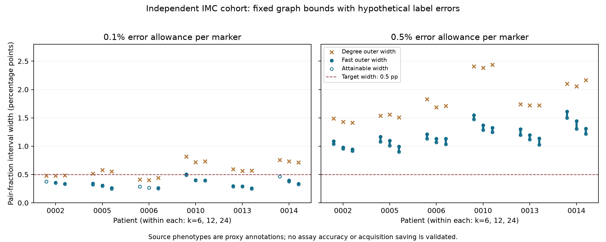

# Independent breast-tumour cohort: conditional graph bounds transfer

**Without refitting the bound algorithm, all 36 independent-cohort intervals
tighten the degree baseline; 35 have certified endpoint gaps below .1 percentage
points.** The frozen confirmation gate passes. This supports transfer of
conditional graph sensitivity across tissue and imaging platforms. It does not
validate annotation accuracy, virtual marker predictions or acquisition savings.

The [protocol](DANENBERG_CONFIRMATION_PROTOCOL.md) was committed at `dd3041a`
before patient-target evaluation. `general_marker_bounds.py` is unchanged from
`9d8c6da`. [All 36 results](results/danenberg_confirmation.json) retain graph/cell
hashes, budgets, outer intervals and explicit attainable corruption witnesses.
The six patients, rather than the 36 correlated graph and budget settings, are
the biological units represented here.

## Source, target and frozen selection

Data come from [Danenberg et al., Nature Genetics 2022](https://www.nature.com/articles/s41588-022-01041-y),
using the authors' [processed public release 2.1.0](https://zenodo.org/records/7324285)
(DOI 10.5281/zenodo.7324285, CC-BY-4.0). This is breast-tumour imaging mass
cytometry, independent of the ORION colorectal development cohort. Source
phenotypes derive from measured channels; they are proxy annotations, not an
independent adjudication of biological identity.

The byte-range fetcher retrieves four table/annotation members. Each member's
uncompressed size and ZIP CRC are verified, and SHA-256 hashes are recorded.
The SingleCells.csv hash is
`9f693514acc02bbb6b2dabd14c15c806348c5b882659aea071a83ed16e2d5df0`.
The whole archive's MD5 was not checked because it was not fully downloaded.
A newer release exists; this analysis pins 2.1.0 and uses its table, not masks.

Of 1,123,466 source rows, 1,047,528 pass the frozen QC, missing-data and
unambiguous-phenotype rules; 75,938 are excluded. Select the lexical first six
eligible patients and each patient's lowest eligible image, requiring at least
500 retained cells. Their 10,066 cells have unique identifiers and coordinates.
No substitutions were made after target evaluation.

A is the source epithelial flag. B comprises exactly `CD4^{+} T cells`,
`CD8^{+} T cells`, and `T_{Reg} & T_{Ex}`. The ambiguous
`CD4^{+} T cells & APCs` class is excluded. B has only 8–28 positives per image.
This epithelial-to-selected-T-phenotype pair fraction differs from the earlier
PanCK/CD3 target and does not include every biological T cell.

Directed k-nearest-neighbour graphs use k=6/12/24, deterministic distance/index
ties, and no cross-image edges. This avoids assuming physical calibration across
platforms, while changing the estimand from radius-based proximity. Both marker
error budgets are ceil(n*.001) or ceil(n*.005). These are hypothetical adversarial
allowances, not measured error rates.

## Confirmation outcomes

Widths and gaps below are percentage points (pp). Width ranges cover all three
graph settings; maximum endpoint gap covers all six settings per patient.

| Patient | Image | Cells | A / B positives | Width at .1% errors each (pp) | Width at .5% errors each (pp) | Max endpoint gap (pp) |
|---|---:|---:|---:|---:|---:|---:|
| MB-0002 | 70 | 2,115 | 1620 / 9 | 0.337–0.378 | 0.944–1.087 | 0.047 |
| MB-0005 | 71 | 1,559 | 861 / 11 | 0.262–0.342 | 0.994–1.165 | 0.086 |
| MB-0006 | 165 | 810 | 274 / 8 | 0.262–0.288 | 1.132–1.214 | 0.098 |
| MB-0010 | 219 | 1,391 | 1129 / 22 | 0.398–0.503 | 1.324–1.546 | 0.078 |
| MB-0013 | 220 | 2,691 | 1852 / 23 | 0.259–0.297 | 1.138–1.301 | 0.105 |
| MB-0014 | 227 | 1,500 | 718 / 28 | 0.339–0.467 | 1.308–1.611 | 0.089 |

- **36/36** intervals strictly tighten the valid degree interval, exceeding the
  frozen requirement of 27/36.
- **35/36** maximum endpoint gaps are at most .1 pp, exceeding 27/36. The remaining
  case is MB-0013, k=6, .5% allowance, with .1053 pp gap. Outer bounds and
  attainable corruptions bracket each exact endpoint; this is not exact optimality.
- At **.1% allowance per marker**, 17/18 intervals have width at most .5 pp.
  The remaining MB-0010, k=6 interval is .5032 pp wide; its attainable range is
  .4913 pp. The requested precision is unresolved there, not proven impossible.
- At **.5% allowance per marker**, 0/18 meet .5 pp precision. All 18 have feasible
  corruptions spanning more than .5 pp, proving that precision impossible under
  those allowances even with full acquisition of source calls.

The bound alone takes .45–3.14 milliseconds per case on this host, excluding
data access, graph construction and physical measurements. This is not an
end-to-end throughput or instrument-efficiency result.



## Research consequence

The [ORION development study](GENERAL_MARKER_RESULTS.md) found .1% uncertainty
in both markers already prevented .5 pp precision in all nine graphs. Here,
17/18 graph settings guarantee it. Both results must remain visible: graph
structure, source prevalence, mapping and integer budgets change sensitivity.
A universal assay-error threshold does not follow. Calculate specimen- and
claim-specific requirements instead.

The useful next question is whether independently calibrated physical reviews
can meet those requirements more cheaply than uniform or degree-prioritized
review. Freeze that comparison before new outcomes, retain fallible references
and both-marker errors, and count batch/feedback costs. The [lab pilot](LAB_PILOT_PROTOCOL.md)
remains necessary for actual error and latency calibration. No proprietary
predictor has been run; graphs remain conditioned on measured-image coordinates.
This establishes neither functional cellular interaction nor a clinical biomarker.

The bounds, alternating witnesses and integer-programming references use
classical optimization. Independent transfer strengthens the evidence; it does
not establish new optimization theory or priority over existing methods.

## Reproduce

```bash
python -m pip install -r requirements.txt
python fetch_danenberg.py
python -m unittest discover -s tests -v
python study_danenberg_confirmation.py
python plot_danenberg_confirmation.py
```

Downloading needs an internet connection and about 850 MB for the uncompressed
cell table. Raw files remain ignored by Git. Rerunning preserves the selection;
it does not create a fresh confirmation cohort.
