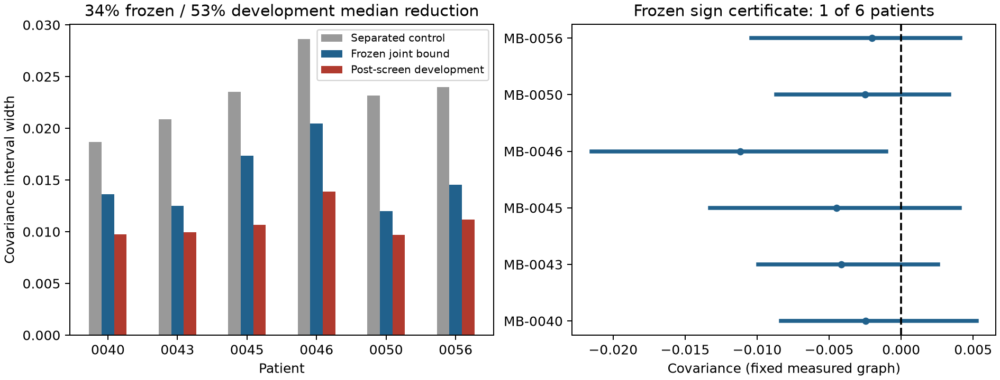

# Conditional enrichment certificates: tighter bounds, limited sign recovery

**The frozen certificate reduces median interval width by 34.0% against a strong
separated-bounds control on six previously unused patients. It certifies the
sign in only 1/6, so the combined continuation gate fails.** A subsequent
structural tightening reaches 52.9% median reduction on the SAME patients;
that number is development evidence, not a second confirmation.

## What changed

The estimand is degree-adjusted epithelial–selected-T-cell covariance across a
uniformly drawn graph edge: contact fraction minus the product of its two
endpoint abundances. This asks whether spatial association exceeds that
abundance baseline. It is different from the original contact fraction and is
an established covariance/modularity-style quantity. A narrower covariance
interval is not an improvement to the original contact target's interval.

The [protocol](ENRICHMENT_PROTOCOL.md), committed at **d3fec2d**, precedes reading
these patients' target outcomes. Source, QC and class mapping remain the
Danenberg public IMC data used earlier; select the 13th–18th lexicographic
eligible patients, one image of >=500 retained cells each, without prevalence
or target selection. All 36 k=6/12/24 by .1%/.5%-budget combinations are retained.
The primary is k=12 and ceil(.005*n) arbitrary errors per marker.

This is a source-annotation sensitivity study on a fixed measured graph. Budgets
are not measured error rates; source phenotypes are not adjudicated biological
truth. It does not solve the fluorescence-graph failure, H&E transfer, cross-
modality registration, or actual instrument costs.

## Frozen primary results

| Patient | Cells | Budget per marker | Source covariance | Outer interval | Width reduction |
|---|---:|---:|---:|---|---:|
| MB-0040 | 1151 | 6 | -.002458 | [-.008363, .005250] | 27.1% |
| MB-0043 | 775 | 4 | -.004143 | [-.009915, .002565] | 40.3% |
| MB-0045 | 1913 | 10 | -.004476 | [-.013280, .004078] | 26.2% |
| MB-0046 | 1440 | 8 | -.011188 | [-.021501, -.001030] | 28.6% |
| MB-0050 | 1178 | 6 | -.002496 | [-.008658, .003320] | 48.3% |
| MB-0056 | 1333 | 7 | -.002024 | [-.010419, .004110] | 39.5% |

The comparator uses unchanged fast contact bounds plus exact degree-weighted
marginal bounds, propagated separately into the SAME covariance. The direct
method retains covariance cancellation before bounding errors. Its intersection
with the comparator is valid; direct unintersected results remain in the JSON.
Both marker prevalences can change within the budgets. The improvement is not
produced by assuming true prevalence equals observed prevalence.

## Information ambiguity versus computation

Four primary patients—MB-0040, MB-0043, MB-0050 and MB-0056—have feasible
negative and positive endpoint witnesses. Independent integer arithmetic verifies
their budgets and covariance signs. **No algorithm can certify a common sign
over the full stated uncertainty set in those four cases.** This is conditional
on the fixed-graph, independent binary Hamming uncertainty model. The set allows
marker overlap; biological exclusivity or additional reference constraints could
exclude some witnesses. The result is not impossibility of learning true tissue
biology from richer measurements.

MB-0045's fast interval crosses zero but both found witnesses are negative.
That is an optimization gap, not a proved ambiguity. A separately frozen,
[post-screen reference](ENRICHMENT_REFINEMENT.md) conditions on each of 21 possible
true A counts, then runs a standard sparse MILP. All slices hit the requested
one-second solver limit without a dual bound or integer incumbent. Actual
wall time was 110.65 seconds, including solver preprocessing/overhead. **No global
bound was obtained**, and no missing bound is replaced by a point estimate.
Small instances match exhaustive binary-world optima. The recorded limited
solver outcome is retained rather than repeatedly rerun for a favorable result.

## Structural development after the screen

The [sparse interaction bound](ENRICHMENT_THEORY.md) improves the calculation:
for each potential flipped cell, add a cap for its possible interactions BEFORE
selecting the highest-gain cells. Derive row and column variants, for both
objective signs, with separate sparse and rank-one label classes. This retains
more coupling than adding one global interaction cap after linear maximization.
It avoids a dense n-by-n covariance matrix and uses graph passes and sorting.

This post-outcome development protocol was committed at **233a362** before its
results. On all 36 already-read cases, the original artifacts remain unchanged.
The primary six now have median width reduction **52.9%** but still only **1/6**
signs certified. MB-0045's upper bound tightens from .004078 to .000790 and
remains unresolved. No additional patient sequence is screened to hunt for a
passing confirmation. None of this changes the original failed gate.



## Decision and novelty

Keep the sparse contrast certificate as a concrete algorithmic result. Its
34% frozen width improvement is supported; a claim of reliable sign recovery
at .5% label error is not. The 53% development improvement needs a new frozen
confirmation before use as a replicated effect size. Measured graph/marker
calibration and acquisition savings remain open.

The narrow research lead is joint, target-specific propagation of structured
label and geometry errors, plus measurements that separate feasible opposite-
sign populations. Replacing the architecture name or adopting a known enrichment
statistic does not create that contribution. Existing modularity, metadata-mixing
bounds, KAMP and graph-robustness work are linked in the protocol. Priority for
this particular certificate is unestablished; these outcomes do not earn a
9–10 novelty score by themselves.

```bash
python study_enrichment.py
python refine_enrichment.py
python plot_enrichment.py
python -m unittest discover -s tests -v
```

The source CSV and its recorded hash are required; fetch as in the earlier
Danenberg confirmation. Refinement reuses an existing recorded bounded-solver
reference if present rather than repeatedly rerunning for a favorable outcome.
