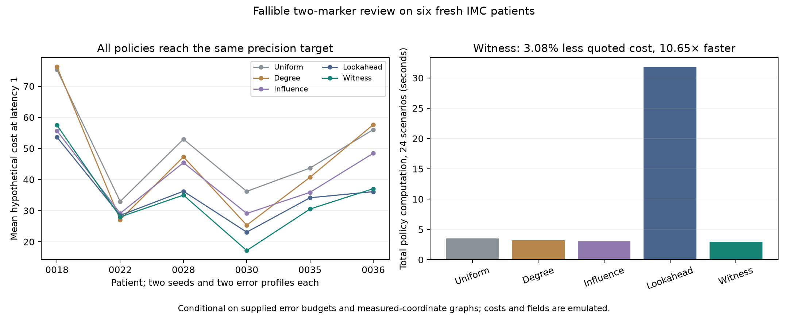

# Fallible-reference review on six fresh patients

**All five policies keep the proxy target inside their bounds and reach .5
percentage-point width in all 24 corruption scenarios. The witness policy's
3.08% mean quoted-cost improvement over the strongest control fails the frozen
10% continuation gate.** Its roughly tenfold lower computation time is a useful
secondary observation, not proof of physical savings or a new general policy.

The [protocol](FALLIBLE_POLICY_PROTOCOL.md) was committed at `1401618`; policy
implementation `3ce386c` preceded patient evaluation. A Python-boolean JSON
serialization fix at `6141ece` changed no mathematical rule or observation.
The [new conditional bounds](FALLIBLE_BOUNDS_THEORY.md) permit errors in both
markers and in the partial reference. The earlier raw-only bound at `9d8c6da`
remains unchanged. [All 120 policy/scenario runs](results/fallible_policy_study.json)
retain every interval transcript, attainment, costs, runtime and input hashes.

## Fresh patients and observation model

The source is the authors' [Danenberg breast-tumour IMC release 2.1.0](https://zenodo.org/records/7324285),
with the same frozen QC/mapping as the [earlier graph-bound confirmation](DANENBERG_CONFIRMATION_RESULTS.md).
Select eligible patients seven through twelve lexically and each lowest eligible
image. These six patients were not used in the earlier six-patient confirmation.
They contain 8,716 cells. Use kNN k=12 and fixed 4x4 coordinate-grid emulated
fields, without assuming scanner dimensions or physical pixel calibration.

Both marker raw-call error allowances are ceil(.005*n). Corruptions are either
uniform random or selected by source-target influence; that adversarial generator
is unavailable to the policy. There are two seeds per patient/profile. Each
reference has one persistent wrong cell per marker, fixed before review. The
policy is given B and E=1, not the hidden cells or their true labels. These are
hypothetical bounded errors, not observed assay/reference error estimates.

Raw calls and measured-coordinate graphs are known initially. Reviewing a field
reveals both reference markers for its cells. Thus this tests review after a
raw-call census. It is not end-to-end acquisition or prediction from H&E. Source
phenotypes are proxy truth for emulation, not independent biological adjudication.
Two selected images have no B-positive source cells; these difficult/degenerate
targets were retained rather than substituted.

## Complete policy comparison

Primary quoted cost is fields + .02*reviewed_cells + feedback_rounds. A field
contains both markers, and each field is reviewed at most once. All costs are
dimensionless assumptions. The adaptive rules use field-plus-cell cost to rank
actions. Latency changes are reported post hoc without retuning the policies.

| Policy | Mean fields | Mean reviewed cells | Mean primary cost | Total policy computation (s) |
|---|---:|---:|---:|---:|
| Uniform fields | 12.71 | 1205.96 | 49.54 | 3.51 |
| Degree priority | 11.00 | 1186.83 | 45.74 | 3.22 |
| Static raw-target influence | 10.08 | 1022.42 | 40.62 | 3.01 |
| Bound-width proxy lookahead | 9.04 | 860.38 | 35.29 | 31.80 |
| Endpoint-witness disagreement | 8.54 | 856.08 | 34.21 | 2.99 |

Each row covers all 24 scenarios and reaches the same .5-point precision target.
Witness costs improve 15.8% over static influence and 30.9% over uniform, but
the correct strongest frozen comparison is lookahead: **3.08%**, not 30.9%.
Quoted savings versus lookahead are 2.23%/3.08%/4.65% at latency 0/1/8. Witness
policy computation is 10.65 times faster on this host, including its bound
updates but excluding source loading and graph construction. Different endpoint
widths at stopping and the bounded witness heuristic also affect this tradeoff.

Patient-level mean primary costs across both seeds and profiles:

| Patient | Image | Cells | A / B positives | Uniform | Degree | Influence | Lookahead | Witness |
|---|---:|---:|---:|---:|---:|---:|---:|---:|
| MB-0018 | 228 | 2,663 | 2459 / 16 | 75.31 | 76.31 | 55.69 | 53.66 | 57.48 |
| MB-0022 | 230 | 612 | 390 / 25 | 32.97 | 27.09 | 29.14 | 28.50 | 27.99 |
| MB-0028 | 231 | 1,419 | 1418 / 0 | 52.98 | 47.30 | 45.42 | 36.24 | 35.00 |
| MB-0030 | 221 | 865 | 367 / 11 | 36.20 | 25.34 | 29.11 | 23.09 | 17.18 |
| MB-0035 | 475 | 1,408 | 1133 / 0 | 43.69 | 40.73 | 35.88 | 34.15 | 30.52 |
| MB-0036 | 155 | 1,749 | 1503 / 5 | 56.06 | 57.66 | 48.45 | 36.10 | 37.06 |

The witness policy is worse than lookahead in two patients and better in four;
degree beats both on MB-0022. Under uniform raw errors, witness improves only
.70% over lookahead; under influential errors, 6.54%. Neither demonstrates the
required 10% overall improvement. These are six biological units and 24
corruption scenarios, not 120 independent patient replications.

All 120 transcripts enclose their source-proxy target at every step. Final
witness-policy endpoint gaps are at most .0939 points, with final outer widths
.2312–.4933 points. Early-transcript gaps can reach .4444 points. Feasible
corruption witnesses certify these gaps without asserting exact global optima.
Systematic reference errors leave a floor even after full review.



## Decision

Retain the two-source bound and its tests. Stop the claim that this witness rule
provides a major review-cost reduction: its written continuation gate failed.
The compute tradeoff merits a separately specified evaluation on larger graphs
and multiple claims; it is not a retroactive pass. More tiny policy variants on
these six patients would not create independent evidence or establish novelty.

Actual assay error budgets, field geometry, review error, timing and feedback
latency still require the [lab pilot](LAB_PILOT_PROTOCOL.md). No proprietary
predictor has been evaluated. The next useful deliverable is a calibrated
review/measurement benchmark at valid precision, not another staining model or
an unsupported physical-saving claim.

```bash
python -m unittest discover -s tests -v
python fetch_danenberg.py
python study_fallible_policy.py
python plot_fallible_policy.py
```

Raw data remain ignored. Rerunning preserves the frozen six-patient selection
and creates no new confirmation data.
