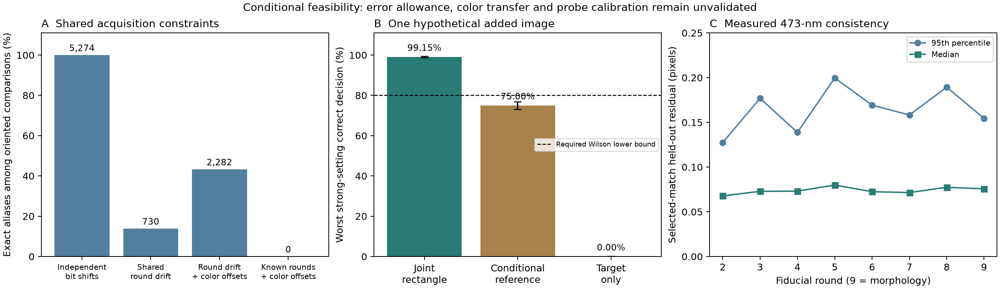

# Shared fiducials, conditional ambiguity and one added image

2026-10-30. Continue this measurement question; defer submission and novelty upgrades.
A conventional joint-count control passes the synthetic reliability gate.
Source-specific calibration and independent molecular truth are still missing.



## Acquisition structure removes many aliases

The source metadata has two gene colors per round, with color order swapping
between some rounds. Across 858 previously fixed gene-only binary-sum classes,
there are 5,274 oriented comparisons. Exact aliases at nonzero separation are:

| Allowed nuisance differences | Aliases / 5,274 |
|---|---:|
| Independent bit translations | 5,274 |
| Shared round translations | 730 |
| Shared round translations plus constant color offsets | 2,282 |
| Exactly known round translations, constant color offsets only | 0 |

These are configurations under fixed equal brightness/source geometry, not
observed tissue frequencies. The full witnesses and direct-equation checks are
retained. With freely centered per-round errors, the fixed claim's alternatives
can alias at per-world drift radius d/2 for at least one gene orientation. Actual
fiducial constraints further restrict that model as below.

## What the real fiducials establish

The checksum-verified field-000 array contains nine 473-nm fiducial planes.
Of 300 retained peaks per plane, rounds 2..9 have 235..253 mutual matches each,
with 125..135 matches in checkerboard-held-out tiles. Their held-out median
residuals are .068..080 pixels; 95th percentiles .127..200 pixels. Round 1 is
the identity reference and is not validation. All 2,233 matches including that
reference are saved. The ninth round is morphology and is excluded from the
eight-round gene ambiguity calculation.

These diagnostics cannot be promoted to error bounds: selected/truncated matches,
prior whole-image fitting and the unmatched peaks limit interpretation. Gene
colors are 561/650 nm. No cross-color accuracy was measured.

The [separately frozen extension](FIDUCIAL_SET_PROTOCOL.md) conditions on every
retained bead displacement. Its uniform coordinate-error contract is incompatible
with the actual matches at ell=.1 or .25 pixels. The smallest allowance making
all eight gene-round intervals consistent is **.29830 pixels**. This is a
consistency threshold for selected matches, not an estimated calibration bound.

At ell=.5, the four oriented fixed-target alternatives have maximum ambiguous
separations from .20170 to .51441 pixels across the two tested axes. At ell=1,
the corresponding range is .70170 to 1.51441 pixels. These ranges pool different
comparisons/axes; there is no single universal threshold. All 16 primal/dual
certificates are retained in [the conditional-set output](results/fiducial_sets.json).
They describe exact mean-image overlap under the specified model, not noisy
decoding performance or verified molecular separations in this tissue.

## One image with a target and background reference

The [first protocol](FIDUCIAL_MEASUREMENT_PROTOCOL.md), commit ee47e68, and
estimator a504eb1 preceded the first 288,000 unique simulated experiments. The
conditional rate test passes error control but **fails** strong-signal decisiveness:
at b=2, delta=.25, eta=8, dose=64, true absence is correctly resolved in 75.05%
of 2,000 trials (Wilson interval 73.11..76.90%). This failure is retained.

The [follow-up protocol](PAIRED_REFERENCE_JOINT_PROTOCOL.md), commit 0a55e8b,
and estimator 871a96a preceded a new 288,000-experiment screen. It deliberately
reuses the same mechanistic grid with a fresh seed; that is development validation,
not independent biology. Each method receives the same saved target counts;
reference methods also receive the same background counts.

| Method on new draws | Worst strong-signal correct decision | Lowest Wilson lower bound | Largest incorrect rate, full grid | Frozen gate |
|---|---:|---:|---:|---|
| Joint Poisson rectangle | 99.15% | 98.64% | .90% | Pass |
| Conditional reference | 75.00% | 73.06% | 3.05% | Fail |
| Target-only | 0% | 0% | 3.00% | Fail |

The strong gate requires a correct-decision Wilson lower bound >=80% in all 12
b/delta/truth settings at eta=8,dose=64. Error control additionally requires an
incorrect-decision Wilson upper <=7.5% in every full-grid setting. All 144 settings
per method, including weak/overlapping signals, remain in the outputs. Passing
does not mean every low-dose or low-efficiency case is settled.

The design assumes an independently specific gene probe, a target-free background
ROI with 16 times the target area, bounded mismatch and minimum probe efficiency.
One image is an assumed simultaneous acquisition at hypothetical photon dose;
64 means a dose multiplier, not 64 images or measured seconds. Chemical/probe
preparation and instrument costs have not been measured. This is a conditional
feasibility result using standard inference, not a new statistical mechanism.

Under the separately declared out-of-contract null (50% background mismatch while
assuming zero), the joint method abstains in 99.9% and falsely declares presence
in .1%; the conditional method abstains in 99.95% and falsely declares presence
in .05%. The joint abstentions have both flags set: the data contradict both
allowed intensity models. The target-only control declares false presence in
100%. This single stress does not validate robustness to arbitrary misspecification.
Within the larger allowed model, eta_min<=2*delta*b creates exact joint-law
ambiguities; no amount of dose can settle them. See [derivation and limits](FIDUCIAL_MEASUREMENT_THEORY.md).

## Reproduction and decision

Full geometry witnesses and comparison rows are retained losslessly in
[compressed JSON](results/fiducial_geometry_witnesses.json.gz), with its checksum
in the readable summary. Standard gzip/JSON tools can inspect every case.

```sh
python study_fiducial_measurement.py --dataset-root ../dataset-release-v0
python study_paired_reference_joint.py
python study_fiducial_sets.py
python verify_fiducial_measurement.py
python make_fiducial_figure.py
python -m unittest discover -s tests -v
```

The original release remains unchanged. Source authors are Tsui et al.,
[DOI 10.5281/zenodo.15678603](https://doi.org/10.5281/zenodo.15678603), CC BY 4.0;
derived peak/match tables, acquisition layout and checksums retain attribution.
The independent replay checks 5,274 geometry cases, 2,233 matched displacements,
16 optimality certificates and 1,440,000 saved experiment-method decisions using
alternative distribution formulas. It does not independently validate bead
identity, raw peak detection or biological truth. **107 local tests pass.**

The real claim remains unresolved. The [prepared pilot plan](REFERENCE_PILOT_PLAN.md)
specifies the missing controls and error ledger. Obtain a calibration specimen with reference
spots visible in all relevant colors, target-positive/negative probe controls and
preselected background regions. Freeze error/efficiency bounds on calibration
fields before checking coverage and claim resolution on a new field. Keep novelty
approximately 6.5/10 and research quality 7.5/10, with roughly one-point judgment
uncertainty. Stronger verification and a passing conventional control improve
the foundation; they do not establish a new decoder or paper-level priority.
