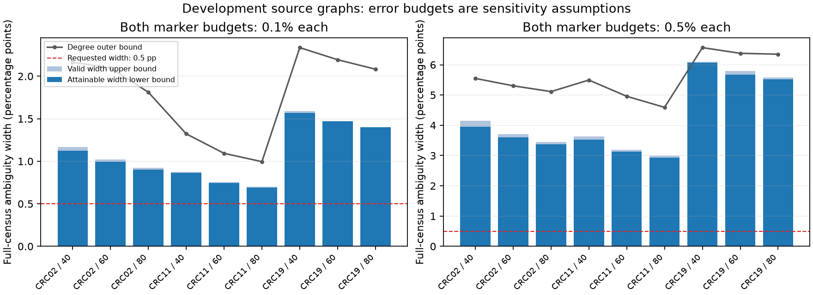

# General marker errors: tight bounds, explicit gaps and assay requirements

**The one-A-error restriction can be removed.** On the three development source
graphs, fast bounds for arbitrary specified A/B error budgets tighten every
label-blind degree interval. Attainable corruption witnesses certify maximum
endpoint gaps below 0.1 percentage points in 16 of 18 cases. These are valid
conditional sensitivity bounds, not estimated assay errors or statistical
confidence intervals over biological truth.

The [general-budget protocol](GENERAL_MARKER_PROTOCOL.md) was committed at
`c10c31e` before outcomes. Its continuation rule passes. A separate
[assay-tolerance analysis](ASSAY_TOLERANCE_PROTOCOL.md) and documented refinement
translate precision into requirements for the future lab pilot. No independent
cohort, actual acquisition saving or new virtual-staining architecture is claimed.

## Optimization formulation and prior art

For true binary labels A_i,B_j and a fixed directed graph E, minimize/maximize
sum_(i,j in E) A_i B_j. For each observed marker vector c, impose

    sum_i observed [c_i + (1-2*c_i)*A_i] <= error_budget.

Use B for the second marker. Optional reference calls impose additional such
constraints, restricted to the reviewed cells and with their own error budgets.
No independence between raw and reference errors is assumed. An empty feasible
set rejects the joint budget/observation assumptions.

Introduce edge products z_ij with 0<=z<=1, z<=A_i, z<=B_j,
z>=A_i+B_j-1. Binary A/B force z=A_i B_j exactly. The linear relaxation permits
fractional labels and gives outer bounds, not admissible true populations.
The [SciPy MILP interface](https://docs.scipy.org/doc/scipy/reference/generated/scipy.optimize.milp.html)
uses HiGHS. The implementation retains solver status, primal values, dual bounds
and separately verified integer witnesses. A time-limited incumbent is never
presented as the optimum; missing dual bounds fall back to [0,1]. Bounds include
small outward numerical padding. These are floating solver bounds, not formal
rational arithmetic certificates.

Binary product linearization, McCormick relaxations, alternating optimization
and robust budget sets are established tools. Related robust optimization work
includes [Buesing, Gersing and Koster](https://doi.org/10.1007/s12532-022-00232-2),
whose uncertain-objective problem differs from the two-marker feasible-population
problem here. This project does not claim a new general MILP formulation or
priority over robust combinatorial optimization. The contribution investigated
is useful, auditable precision bounds for a particular spatial claim and
observation contract.

## Fast bound and attainable witnesses

Let N=sum A_i B_j for the recorded calls, w_i=sum_out(i) B_j and
z_j=sum_in(j) A_i. To maximize a nonnegative pair readout under at-most budgets,
only 0-to-1 flips are needed: removing any opposite-direction flip cannot worsen
the objective. With selected eligible flips x_i,y_j, the exact increase is

    w*x + z*y + sum_(E00) x_i*y_j.

For minimization, use only 1-to-0 flips; the exact decrease is

    w*x + z*y - sum_(E11) x_i*y_j.

Here E00/E11 contain edges whose two recorded endpoint calls are zero/one.
Let Top_k denote the sum of the largest min(k,count) eligible nonnegative scores,
and let d_i/e_j be outgoing/incoming degrees in E00. For A/B budgets a,b, a valid
upper bound on the increase is the minimum of

    Top_a(w+min(d,b)) + Top_b(z)
    Top_a(w) + Top_b(z+min(e,a))
    Top_a(w)+Top_b(z)+min(Top_a(d),Top_b(e),a*b).

Each follows by assigning at most b selected neighbors to an A flip, or at most
a to a B flip; the graph must be simple and unit weighted. An upper bound on the
decrease drops the negative overlap term: Top_a(w)+Top_b(z), capped by N. Both
are intersected with the independent degree bound and the [0,M] count range.
This gives valid outer endpoints for all populations in the budget set.

Two deterministic alternating top-k searches start from A-first and B-first
flips. Each update exactly maximizes its block objective with the other fixed;
stop at unchanged selections or 20 iterations. Every returned corruption is
explicitly feasible, whatever its optimality. Its gain is a lower bound on the
true extreme gain. Subtracting that from the valid gain upper bound certifies
an endpoint gap. The outer interval contains all feasible targets; the two
witness targets give a lower bound on the unavoidable ambiguity width.
The implementation takes O(T*(n log n+M)) work for T bounded iterations,
with O(n+M) working memory. It is not the earlier special-case linear algorithm.

## Exhaustive checks and solver controls

Tests exhaust all 64 recorded populations, all 64 true populations, and five
budget pairs on a three-cell graph. Both fast outer endpoints contain the true
extrema; every witness attains its reported endpoint. Forty integer problems
match direct enumeration. Separate tests cover fallible-reference constraints,
infeasible exact references, LP outer validity and safe handling of a simulated
timeout with a suboptimal incumbent.

The frozen synthetic screen has 18 random-geometric cases at sizes 12/24/48,
three seeds and budgets 10%/25% per marker. All 36 MILP objective solves finish
optimally within their five-second limits. The LP is strictly looser than the
integer interval in nine cases. The fast bound's largest certified endpoint
gap is 8.87 percentage points here: it is not universally sharp. Synthetic
outcomes must remain distinct from its much smaller development-panel gaps.

## Full development panels

Both marker budgets are ceil(n*fraction). All 18 fast intervals are narrower
than the valid degree outer interval, by 7%-51%. Per-bound time is 2.7-76.7 ms
in this local run, excluding loading and graph checks; this is computation time,
not acquisition or review latency. Sixteen cases have certified endpoint gaps
<=0.1 percentage points; the maximum is 0.132 points. No full-panel MILP optimum
was computed.

At radius 80 native pixels, widths and maximum endpoint gaps in percentage points:

| Patient | Budget fraction, each marker | Fast outer width | Attainable width | Degree width | Maximum endpoint gap |
|---|---:|---:|---:|---:|---:|
| CRC02 | 0.1% | .9256 | .8992 | 1.8113 | .0262 |
| CRC11 | 0.1% | .6994 | .6884 | .9953 | .0110 |
| CRC19 | 0.1% | 1.3989 | 1.3989 | 2.0824 | 0 |
| CRC02 | 0.5% | 3.4433 | 3.3679 | 5.1142 | .0500 |
| CRC11 | 0.5% | 2.9918 | 2.9264 | 4.5931 | .0619 |
| CRC19 | 0.5% | 5.5851 | 5.5161 | 6.3493 | .0594 |

Across all nine graphs at 0.1% per-marker uncertainty, attainable ambiguity is
already wider than the requested .5 points. Thus the precision failure cannot
be explained away as looseness of these outer bounds: actual allowed populations
disagree too much even after complete acquisition. Source annotations are only
the reference around which these possible changes are defined.



## What accuracy would a pilot need to investigate?

Find the largest common integer error budget b for which the sharp ambiguity
width could be <=.005. Certify sufficiency only with a narrow valid outer interval,
and impossibility only with two attainable targets farther apart than .005.
Nested feasible sets make these implications valid at all smaller/larger budgets.
The first binary-search procedure stopped on an unresolved midpoint and left one
[0,56] bracket. A pre-specified amendment then scans every budget on every graph;
its refined results retain all original outcomes in the JSON.

| Patient | Cells | Radius 40: possible maximum budget | Radius 60 | Radius 80 |
|---|---:|---:|---:|---:|
| CRC02 | 56,220 | 21 | 24-25 | 27-28 |
| CRC11 | 72,922 | 39 | 46-47 | 50-51 |
| CRC19 | 11,654 | 3 | 3 | 3 |

Five thresholds are determined exactly; four remain within one cell. The guaranteed
budgets range from .0257% to .0686% per marker; the largest upper bracket is .0699%.
These are adversarial finite-population requirements for this conditional graph
and target, not estimates of actual classifier/assay accuracy, independent
whole-slide validity or clinical acceptance criteria. Their purpose is to make
an assay-calibration pilot falsifiable before promising fine-grained readouts.
[Original and refined tolerance results](results/assay_tolerance_study.json).

## Fallible reference diagnostic

On three eight-cell graphs, raw calls differ from the constructed reference
population in two cells per marker. Reference responses are constructed correctly,
but their admissible set conservatively allows one error per marker. Query four
or all eight reference cells; an ideal zero-error full reference is only a control.
With all eight reviewed and one possible reference error, exact ambiguity widths
are 25.0, 28.57 and 10.0 percentage points. They shrink relative to no review but
remain nonzero. The ideal zero-error control collapses to a point. This tests
conditional information content on tiny graphs, not reviewer performance or
independent biological truth. No active reference policy or reference cost saving
has been demonstrated. [Complete optimization results](results/general_marker_study.json).

## Decision and next gate

Continue **claim-specific assay tolerance and acquisition with fallible references**.
The algorithmic gate passes, and the remaining precision floor is demonstrably
an observation problem in these development cases. Next calibrate defensible
joint error budgets using orthogonal evidence, optimize partial references against
adversarial witness disagreements, compare with strong influence/census controls,
and confirm on unused patients and an independent cohort. Actual scanner feedback
and reference costs remain in the [lab pilot](LAB_PILOT_PROTOCOL.md); no simulated
runtime should be substituted for them.

```bash
python -m unittest discover -s tests -v
python study_general_marker.py
python study_assay_tolerance.py
python study_assay_tolerance.py --refine
python plot_general_marker.py
```
