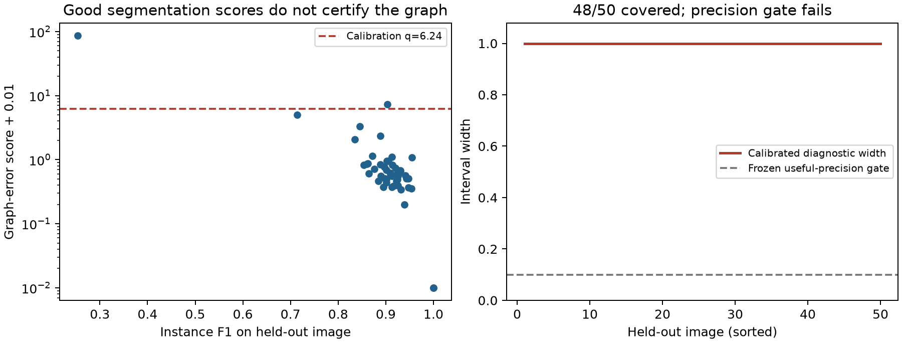

# Manual-annotation graph calibration: coverage without useful precision

**48/50 held-out images satisfy the calibrated edge-error budgets, but all
50 diagnostic intervals are [0,1].** The coverage part passes; the precision
part fails. This closes a real gap in the observation model without supporting
a useful end-to-end spatial biomarker certificate.

## Measured source and fixed split

We used [BBBC039v1, Caicedo et al. 2018](https://bbbc.broadinstitute.org/BBBC039),
available from the Broad Bioimage Benchmark Collection (Ljosa et al., Nature
Methods, 2012). Its 200 fluorescence DNA-channel fields have manual nuclear
annotations. Source images, masks and metadata are CC0. The immutable archive
URLs and SHA256 checksums are retained in results/graph_error.json; raw files
are ignored and the download script checks every archive. The official split
is 100 training, 50 validation/calibration and 50 test fields. All fields,
including empty annotations and failed segmentations, remain in their split.
These are fields from one chemical screen, not independent tumour patients.
Plate IDs overlap across splits; exchangeability is an assumption, not a fact
established by the official partition.

The [protocol](GRAPH_ERROR_PROTOCOL.md) was committed at **80f5d8f** before
segmentation selection or evaluation. Nine classical image-only segmentation
settings were evaluated on training annotations only. The selected setting
uses sigma=1 smoothing, .8 times the Otsu threshold, minimum object size 30,
filled holes, watershed and peak distance 12 pixels. Mean training instance
F1 is .871536. The public manual-mask decoding follows the authors' first-
channel connected-component example. There is no use of manual masks as
prediction inputs and no pre-trained model or test tuning.

Maximum-cardinality IoU>=.5 matching assigns shared IDs offline. Unmatched
predictions and reference nuclei get separate IDs. Radius-40-pixel centroid
graph errors therefore include false/missed nuclei, splits/merges, and changed
neighbors. IoU matching is a fixed scoring convention and can be conservative
for downstream geometry; it is not a perfect account of biological identity.
No reference graph is provided to a sampling policy.

## Results and cost

| Quantity | Result |
|---|---:|
| Mean held-out instance F1 | .893839 |
| Validation conformal rank | 49 of 50 |
| Calibrated max(additions,deletions)/max(1,observed edges) | 6.24 |
| Covered test images | **48/50** |
| Zero-error comparator covered | 2/50 |
| Median test graph-error score | .602632 |
| Median hypothetical quarter-mark interval width | **1.00** |
| Frozen gate: >=47/50 covered and median width <=.10 | **Fail** |
| Manual calibration fields / nuclei / pixels | 50 / 5,896 / 18,096,000 |
| Manual fields used for segmenter selection | 100 additional fields |

The descriptive binomial 95% interval for 48/50 is [.862862,.995119] if images
are treated as independent; shared screen/plate conditions limit that reading.
It is not evidence of verified patient-level 95% coverage. Split-conformal
coverage is marginal under calibration/future-image exchangeability, not
conditional on each image and not guaranteed across a domain shift.

The high quantile is not a rounding error: some fields contain many manually
annotated nuclei but very few recovered predictions. A graph normalized by
predicted edge count is especially vulnerable to those failures. The resulting
budget permits deleting the whole observed graph. Mean instance F1 hides this
tail and does not imply useful worst-case marked-pair inference. Reducing the
quantile after observing the test set would invalidate this confirmation.

The quarter-mark example is a precision diagnostic at a hypothetical observed
marked-edge fraction .25. **There are no measured tumour/T-cell labels in this
benchmark.** These are not observed biological effect intervals. Manual
annotation costs are charged as whole fields, nuclei and pixels; annotation
minutes, acquisition timings and feedback latency remain unknown. The result
JSON also records all 100 training fields' annotation counts and pixels; those
labels are not free calibration. Public reuse is computationally inexpensive,
but does not estimate a laboratory's cost. Recorded compute time is not scanner
time. The Pillow dependency pin was corrected to the installed version before
evaluation; the frozen procedure and gate are unchanged.



## Theory and decision

The [edge-edit propagation result](GRAPH_ERROR_THEORY.md) encloses a marked-edge
fraction under uncertain numerator AND denominator, with explicit empty-graph
handling. It composes with the existing label-count bounds and includes the
separate graph and label error probabilities. Tests exhaustively enumerate
small edge-edit worlds; the original general_marker_bounds.py is unchanged.
The actual radius-graph/vertex-label feasible set is tighter than this relaxation,
so these endpoints need not be attainable in that more constrained problem.

Keep this calibration benchmark and its failure. Do not add "experimentally
validated graph robustness" or hardware savings to the headline. It validates
a limited coverage observation and exposes a failed useful-precision gate.

Before another confirmation, choose a materially stronger image-only detector
using training data or a new development cohort, address missed-object tails,
and obtain paired H&E/multiplex fields with independently adjudicated masks and
marker calls. Freeze the target and a calibration cost budget on that cohort.
A target-specific calibration of the actual spatial functional may be much
less conservative than uniform graph edits, but would require actual marker
annotations and a new held-out confirmation; it is not established here.
No new hardware-cost or independent-patient biology claim follows from BBBC039.

STARLING already models segmentation errors; its released pellet labels include
model-derived assignments, not per-cell adjudicated truth. The Bruhns et al.
segmentation benchmark provides a curated baseline proxy for truth, largely one
patient. Those datasets are useful, but cannot be repurposed as measured marker
error probabilities without further evidence. Prior work and exact differences,
including conformal instance-segmentation sets, are linked in the protocol.
No generic uncertainty-method priority is claimed.

```bash
python -m pip install -r requirements.txt -r requirements-geometry.txt
python study_graph_error.py
python plot_graph_error.py
python -m unittest discover -s tests -v
```
