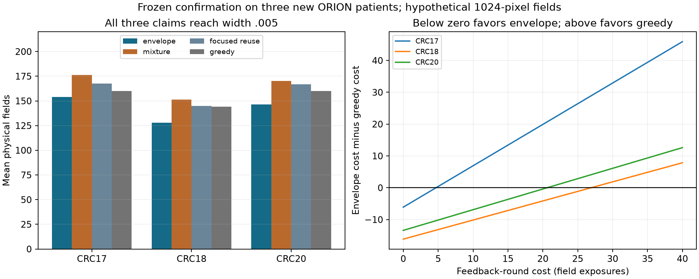

# Shared acquisition passed its frozen three-patient confirmation

**One fixed shared sampler certified three nested spatial readouts using 8–16%
fewer physical fields than two strong sampling controls on three new patients.**
Every target reached width .005, with a joint 95% confidence-sequence guarantee
conditional on the source graph and exact marker calls. Feedback rounds and
camera dimensions are simulated; these are not measured instrument-time savings.

[Protocol](MULTICLAIM_CONFIRMATION_PROTOCOL.md) and implementation were committed
and pushed at `69ef382f05f28bd814db656231331888e8a0f7b5` before downloading the
CRC17/18/20 cell tables. Source-author S3 names verified the P37_S49/S50/S52 mapping.
The complete report retains source SHA256, preparation checksums, implementation
checksums, individual acquisition paths and the protocol commit:
[results](results/multiclaim_confirmation.json).

## Frozen comparison

32 coordinate-selected cores forming one panel per patient, the existing radius-80 graph,
and three geometry-fixed PanCK/CD3e positive-pair fractions at radii 40/60/80
native pixels. Hypothetical camera field 1024 pixels; batch 16; joint alpha .05
allocated equally across claims; width .005 for every target; 4096 total queries.
Twenty repeats per stochastic method and one deterministic run per patient.

The predeclared primary criterion required envelope attainment >=.95 and strictly
lower mean field count than both equal-mixture and focused-reuse sampling in
EVERY patient, with both controls attaining >=.95. It passed in all three.
This criterion compares conditional Monte Carlo means; it is not a significance
test or an estimate of an entire patient-population effect.

| Patient | Envelope fields / rounds | Mixture fields / rounds | Focused reuse fields / rounds | Greedy fields / rounds |
|---|---:|---:|---:|---:|
| CRC17 | **153.90 / 11.30** | 176.25 / 13.10 | 167.75 / 12.35 | 160 / **10** |
| CRC18 | **127.85 / 9.60** | 151.35 / 11.45 | 145.05 / 11.10 | 144 / **9** |
| CRC20 | **146.60 / 10.65** | 170.35 / 12.70 | 166.75 / 12.30 | 160 / **10** |

Envelope field reductions versus mixture are 12.7%, 15.5% and 13.9%; versus
focused reuse they are 8.3%, 11.9% and 12.1%. The focused-reuse control caches
all measured cells and updates every claim supported by its proposal. The gain
therefore survives a control that reuses measurements and eligible statistics.

All 180 stochastic paths reached every target and covered all three truths at
every inspected boundary. All three deterministic runs also completed and
covered. There were no empty sets. These outcomes do not establish 100% coverage:
the theorem gives at least 95% under its assumptions, and only three patients
provide biological replication.

The panels contain 110,135 / 85,630 / 85,095 cells. The three edge counts are:

| Patient | Radius 40 | Radius 60 | Radius 80 |
|---|---:|---:|---:|
| CRC17 | 436,212 | 1,011,471 | 1,793,300 |
| CRC18 | 411,130 | 951,116 | 1,688,763 |
| CRC20 | 340,261 | 788,382 | 1,398,127 |

Overlapping distance claims and edges are not independent observations or three
different proteins. Each panel passed 100 neighbor checks against the complete
source cell table. Source fluorescence segmentation and threshold calls define
the target; no H&E-only detection graph was validated.

## The physical-cost qualification remains material

For cost `fields + h*feedback_rounds`, envelope beats greedy only below h=4.69,
26.92 and 20.62 field-equivalents per round for CRC17/18/20 respectively. At h=100
greedy wins all three comparisons. Actual instrument h, random-access capability,
caching and field size have not been measured. Uniformly claiming time or money
savings would be unsupported.

## What was added scientifically

[The theory](MULTICLAIM_THEORY.md) derives the envelope proposal's minimax
importance-range property, bounds the benefit of overlapping claims, and shows
why natural resolved-edge utility need not be submodular. A strong greedy
competitor is therefore an empirical control, not a method whose approximation
guarantee follows automatically. Multiple importance sampling, betting inference,
and batch acquisition are established ingredients.

The development loss on CRC19 remains in the report; new-patient confirmation
does not turn the proposal into a universal optimum. This result supports shared
spatial certification as a research direction. The next gates are several marker
pairs and decision-relevant contrasts, source-call/segmentation error, a genuinely
independent cohort, and instrument costs. No Strand model, clinical diagnosis,
functional interaction or treatment effect was evaluated.

Reproduce: fetch the pinned source members with `python confirm_multiclaim.py`,
then `python plot_multiclaim_confirmation.py` and the unit tests. Raw tables and
prepared arrays are excluded from Git; their hashes and checks remain recorded.
