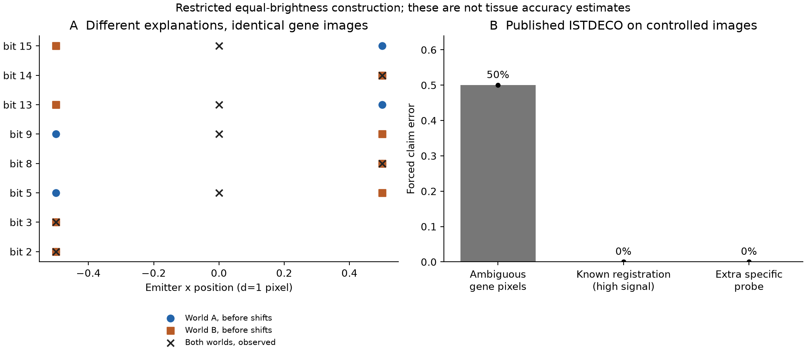

# Full-pixel ambiguity and published decoding

2026-11-01. Protocol 29a7eb4; implementation 1995e67. The unchanged original
[ISTDECO](https://github.com/axanderssonuu/istdeco) comparator is pinned at
264c9383a2d73d5669561bff179fd4c359d2e103, with its MIT license and SHA256 values
preserved in `third_party/istdeco`. This is an actual executed implementation,
not a local imitation of its objective.



## A restricted full-image result

For the four previously declared gene-pair alternatives, the complete expected
pixel stacks agree within the frozen 1e-9 tolerance under the constructed
round/color registration shifts. This holds for both separations and exposures.
The [proof](PIXEL_INFORMATION_THEORY.md) applies to any common translated PSF
and repeated gene exposures under the stated equal-brightness contract.

| Fixed synthetic comparison | Outcome |
|---|---:|
| Paired identical-image cases | Exactly 50% forced error across the two worlds |
| High-signal, correctly registered controls (d=3, E=16) | 96/96 correct |
| All correctly registered controls | 384/384 correct |
| ISTDECO with the extra specific probe | 384/384 correct |
| Conventional Poisson test of the same probe | 384/384 correct |

All five frozen gates pass. There are 960 synthetic decoder calls plus 20
measured-crop calls. Each paired input is intentionally assessed against both
possible worlds; these are not 384 independently acquired tissue observations.
The full codebook, including six blanks, is supplied in every decoding run.
The predefined pair-mass readout evaluates a claim; it is not the authors'
spot-calling/FDR procedure. The extra probe is idealized and is supplied to both
methods. Its success is not evidence for a novel decoder or acquisition savings.

## Real image diagnostic

All four fixed measured development crops were processed under nominal and
four fiducial-tile registrations. Their dominant genes do not change (Akt1,
Akt1, Slc2a1 and Jun). Maximum total-mass L1 changes relative to the nominal
recovered masses range from 2.19% to 2.57% across crops. This particular diagnostic
is fairly stable; it does not support claiming that those four fields demonstrate
large decoding instability in those four crops from the same field.

The images are source TIFF-derived, oriented middle-plane data followed by
shared bandpass/normalization/registration preprocessing. The decoder sees
prepared pixels. No independent molecule identities are available, so these
outputs cannot establish accuracy, FDR, sensitivity or biological conclusions.
An independently annotated raw-image validation cohort remains missing.

## Reproduction

```sh
python -m pip install -r requirements.txt -r requirements-geometry.txt -r requirements-decoder.txt
python study_pixel_decoder.py --dataset-root /path/to/dataset-release-v0
python verify_pixel_decoder.py
```

The verifier checks unmodified upstream source hashes, 64 independent center
identities (also with a non-Gaussian PSF), and all 960 saved synthetic decoder
mass/claim readouts. Hosted CI additionally reruns the complete synthetic decoder
grid. This is independent code verification, not outside expert feedback.

The closest White et al. spots-first pipeline is executed separately under
SYNDROME_PIXEL_PROTOCOL.md; [its results and convergence failure](SYNDROME_PIXEL_RESULTS.md)
are retained. It recovers the exact true pair in 8/8 noiseless,
correctly registered controls; its original measured run hits the fitting cap
in all 16 bits. Twelve small decoded networks are independently checked by
exhaustive feasible-set enumeration. The measured follow-up is kept separate.
For calibration and priority limits, see [the review packet](INDEPENDENT_REVIEW_PACKET.md).
