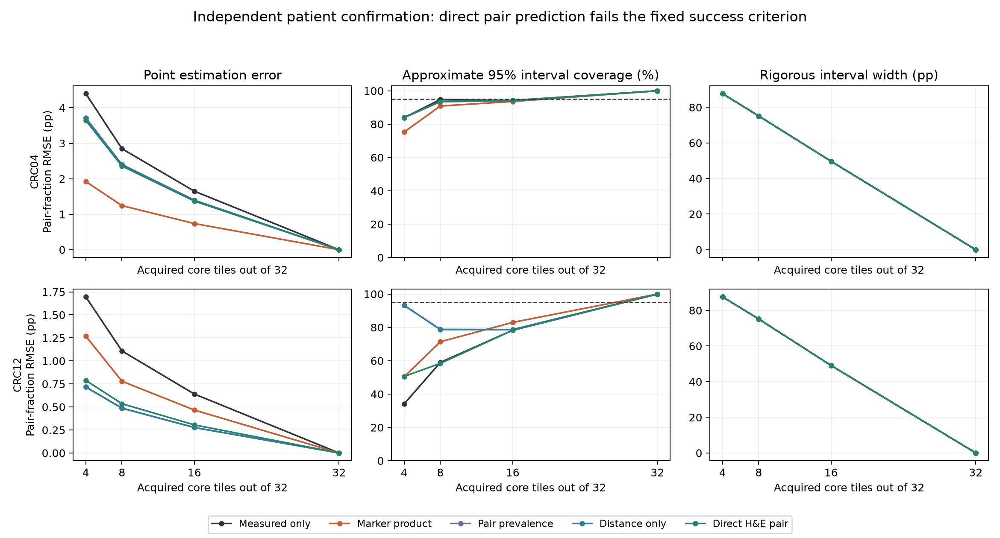

# Measuring confidence in virtual spatial marker readouts

**Which physical measurements are needed to certify a spatial claim?**

The current direction is [shared spatial certification](MULTICLAIM_THEORY.md).
**A frozen three-patient confirmation found 8%-16% fewer camera-field exposures
than strong sampling controls while certifying three nested spatial readouts.**
All targets reached half-percentage-point width with joint 95% error control;
the instrument geometry and timing are simulated. A deterministic greedy control
wins when feedback latency is high. [Protocol, patient-level results and cost
boundaries](MULTICLAIM_CONFIRMATION_RESULTS.md).

The [batched-acquisition study](BATCH_ACQUISITION_RESULTS.md) established the earlier
single-claim observation model.
**Batched acquisition retains a 95% simultaneous confidence guarantee at completed
batch boundaries**, conditional on a fixed source graph and exact marker calls.
In three development patients at a hypothetical 1024-pixel camera field, batches
of 16 reduced feedback rounds by 90%-92% while using 1%-4% more field exposures.
A batched deterministic graph control wins several high-latency comparisons;
the selected research problem includes both kinds of certificate.

The [shared-claim theory](MULTICLAIM_THEORY.md) derives a minimax importance-range
proposal and shows why natural pair-resolution utility need not be submodular.
The next targets are several marker pairs, imperfect marker calls and an
independent cohort, together with instrument-specific cost measurement.
Proprietary virtual predictions have not been evaluated.

Follow-up: [observation reuse and stronger acquisition baselines](RESIDUAL_ACQUISITION_RESULTS.md).
The geometry-only adaptive policy failed. [Tight-precision cell reuse passed on four new patients](CELL_REUSE_CONFIRMATION_RESULTS.md), with savings conditional on how acquisition cost is charged.
The [camera-raster follow-up](RASTER_ACQUISITION_RESULTS.md) compares cached physical fields and a stronger frame-pair sampler, while retaining round-latency tradeoffs.

A small reproducible study of when H&E-derived marker predictions help estimate a spatial protein-pair readout under limited region acquisition.

## Current result

The selected follow-up direction is **acquisition geometry at valid precision**.
A frozen comparison on four additional patients found 128-pixel cores used
84%-89% less union area than 2048-pixel cores to reach a four-percentage-point
confidence width. They required many more ROIs. At half-percentage-point width,
the small-core method failed its 2048-draw budget on two patients, while coarse
regions succeeded. Thus the research target is a cost/precision-aware acquisition
policy, not a universally optimal small ROI. See [acquisition results and limits](ACQUISITION_RESULTS.md).
These are conditional source-graph simulations with classical methods, not
validated instrument savings or a new prediction architecture.

The earlier prediction pipeline works on public measured tissue data. The proposed direct-pair correction **failed its fixed two-patient confirmation criterion**. Prediction-assisted point estimation helps on some patients and hurts on others. Sparse-region Student-t intervals can substantially under-cover; the original rigorous intervals are much wider. Prediction-assisted acquisition savings have not been demonstrated.

This repository implements established prediction/sampling tools and an empirical audit. It does not claim a new estimator, a clinically validated biomarker, or a competitive virtual-staining model.

## Study design

- Training: CRC01 and CRC03. Validation: CRC19.
- Initial development test: CRC02 and CRC11.
- Additional internal confirmation: CRC04 and CRC12, with the direct-pair protocol committed before model fitting and outcome evaluation.
- Same-section registered H&E with source authors' Pan-CK/CD3e positivity calls. The graph uses measured-image segmentation and is therefore a conditional evaluation graph.
- Fixed 2048-pixel cores with an 80-pixel measurement halo and a radius of 80 native pixels (26 micrometers). The population is the selected panel, not a whole-slide census.
- Each pair is owned by the tile containing its first endpoint. All possible second endpoints within the radius are retained; source-table neighbor spot-checks verify 100 anchors per patient.
- Compare separate H&E marker classifiers, direct H&E pair classification, distance-only classification, pair-prevalence controls, and measured-only estimation.
- Repeat uniform tile acquisition 1000 times per budget. These repetitions measure within-panel sampling uncertainty, not patient replication.

The prepared panels contain 376,307 distinct within-patient cell rows and 5,898,807 owned directed pairs across seven patients. These are not independent biological replicates.

## Independent confirmation at eight of 32 acquired tiles

Point errors and interval widths below are in percentage points. Coefficients were frozen using the validation patient. Both coefficient-one and validation-tuned variants, all budgets and every control remain in the JSON results.

| Patient | Method | Pair-fraction RMSE (pp) | Approximate 95% coverage | Rigorous interval width (pp) |
|---|---|---:|---:|---:|
| CRC04 | measured_only | 2.847 | 94.8% | 75.08 |
| CRC04 | marker_product_tuned | 1.243 | 90.9% | 75.14 |
| CRC04 | pair_image_tuned | 2.358 | 93.7% | 75.14 |
| CRC04 | pair_distance_tuned | 2.396 | 93.5% | 75.14 |
| CRC04 | pair_constant_tuned | 2.401 | 93.5% | 75.14 |
| CRC12 | measured_only | 1.108 | 59.0% | 75.18 |
| CRC12 | marker_product_tuned | 0.779 | 71.4% | 75.18 |
| CRC12 | pair_image_tuned | 0.535 | 58.4% | 75.18 |
| CRC12 | pair_distance_tuned | 0.486 | 78.8% | 75.18 |
| CRC12 | pair_constant_tuned | 0.487 | 78.7% | 75.18 |

The direct-pair model improves over marker-product correction on CRC12 and is worse on CRC04. It does not beat the strong geometry/pair-prevalence controls in average confirmation RMSE. Its 95% approximate interval covers only 58.4% of repeated acquisitions on CRC12 at this budget. Rigorous betting intervals cover all 1000 repetitions here but are about 75 percentage points wide. That is coverage with poor precision, not a successful acquisition-efficiency result.



## Reproduce

Python 3.14 was used. Install the pinned dependencies in a dedicated environment, then run:

```bash
python -m pip install -r requirements.txt
python -m unittest discover -s tests -v
python fetch_data.py
python prepare.py
python run_pilot.py
python confidence_audit.py
python pair_study.py
python verify_data.py
python make_figures.py
```

The fetcher reads only selected compressed cell-table members by verified byte ranges and checksums; it does not download the 118 GiB archive. Image crops are read by remote TIFF ranges. Raw data and prepared arrays are ignored by Git. The baseline uses complete core-owned pair totals; extra partial labels in halos are used only for their owned pair endpoints, so this is not an optimal use of every acquired label. Data requests still require an internet connection and can take several minutes. Saved model objects should only be loaded from a trusted copy of this repository.

`run_pilot.py` evaluates the original development patients only. `pair_study.py` uses the separately named confirmation patients. Rerunning these scripts reproduces the fixed experiments; choosing new settings from their outcomes would require a new protocol and new confirmation data.

## Evidence and limits

- [Initial protocol and pretraining data-format amendment](PROTOCOL.md)
- [Direct-pair confirmation protocol](PAIR_STUDY_PROTOCOL.md)
- [Estimator assumptions, derivation and failure case](CONFIDENCE.md)
- [Initial pilot](results/pilot.json), [stronger controls](results/confidence_audit.json), [confirmation](results/pair_study.json)
- [Source/split manifest](results/data_manifest.json), [source and graph checks](results/data_checks.json)
- [Frozen marker-model choices](results/frozen_model_choices.json), [frozen pair-model choices](results/pair_frozen_choices.json)

Only two patients confirm the direct-pair experiment, within the same cohort. Marker gates are source annotations derived from measured channels, not independently adjudicated cell identities. Source fluorescence segmentation and residual registration error affect the estimand. Image descriptors and small classifiers are deliberately simple baselines. A stronger virtual-staining model, a second independent cohort, an H&E-only graph, and an instrument-specific acquisition cost model have not been validated. These results establish neither a functional cellular interaction nor a treatment effect.

## Sources and prior work

Data: [Lin et al., ORION](https://doi.org/10.1038/s43018-023-00576-1), [authors' release](https://github.com/labsyspharm/orion-crc), and [Balezo et al., processed ORION data](https://zenodo.org/records/15340874). The processed dataset's marker gates are used as provided. This code's license does not change the source data's terms.

Methods: [prediction-powered inference](https://www.science.org/doi/10.1126/science.adi6000), [active statistical inference](https://proceedings.mlr.press/v235/zrnic24a.html), [spatial design-based inference](https://arxiv.org/abs/2608.10356), [graph sampling](https://doi.org/10.1007/s40300-017-0126-y), and [betting inference without replacement](https://arxiv.org/abs/2006.04347).

Related virtual-omics work: [UTOPIA](https://pubmed.ncbi.nlm.nih.gov/41847009/), [Multi-V-Stain](https://www.medrxiv.org/content/10.1101/2024.01.26.24301803v1.full), [miniMTI](https://github.com/ohsu-cedar-comp-hub/miniMTI), and [MIPHEI-ViT](https://github.com/Sanofi-Public/MIPHEI-ViT). Joint marker prediction and uncertainty calibration already have substantial precedent.

## Next scientific gate

Retain this version as a negative/diagnostic benchmark. The next contribution must improve **precision at valid coverage**, beyond a geometry-only control, under a realistic observation model. Better marker AUC or a visually plausible protein map is insufficient. Any new interval or allocation policy needs comparison with established finite-population and active-inference methods, a fixed protocol, and fresh confirmation patients. Do not rename these classical methods or tune against the present confirmation outcomes and report them as new evidence.
