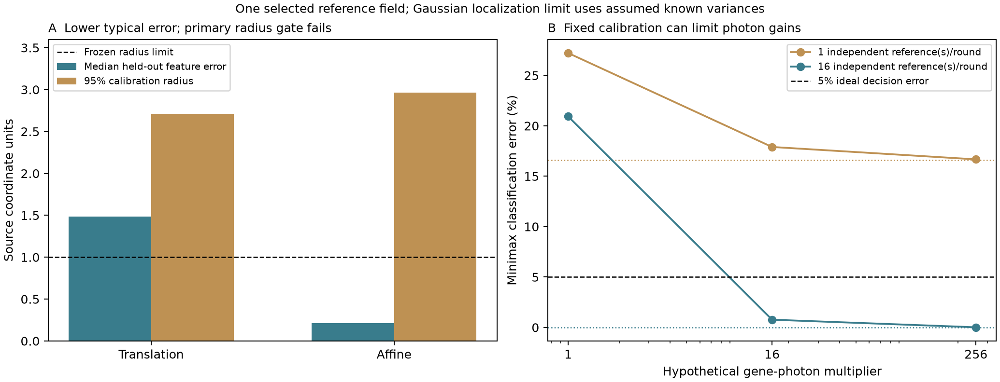

# Calibration benchmark and finite-localization information — 2026-11-01

This round executes the submission plan with a source-independent reference
dataset, a conditional information result and frozen comparisons. It produces
a useful negative calibration outcome and a measurement-design boundary. Full
submission remains deferred.



## Reference benchmark: accuracy improves, the primary radius gate fails

The exact published reference table is retained with its source license and
checksums. Its 680 selected directed matches form 131 physical-feature components;
all repeated channels of a feature remain in one split. Components have at most
one raw position per channel. These are source-assigned matches, not separately
adjudicated identities. There is one source field/position, with no independently
identified specimen cohort.

Protocol f4fd37b and estimator 98a2fcb precede residual scoring. Primary split:
65 training, 32 calibration and 34 test features. Two controls are refitted from
raw comparison/reference coordinates: median translation and least-squares affine
transforms. Author-aligned coordinates never enter fitting or held-out accuracy.
One feature score is the maximum residual over all its available directed pairs.

| Primary control | Median test feature error | 95% calibration radius | Test coverage |
|---|---:|---:|---:|
| Translation | 1.48723 | 2.71277 | 34/34 |
| Affine | .21364 | 2.96318 | 34/34 |

Units remain source coordinate units; no physical pixel scale is inferred.
Affine reduces median error by 85.64%, but its radius exceeds the frozen one-unit
precision requirement. Coverage and improvement gates pass; **precision fails**.
The 95% radius is the largest of 32 calibration feature scores, so a calibration
tail matters even when test medians are small. Do not remove that feature, report
only average errors or relabel the alternate split as the primary success.

In the declared left-to-right spatial-extrapolation stress, affine median test
error is .44606, radius .94391 and coverage 32/34 (94.12%, Wilson 80.91..98.37%).
Translation has median 2.54865, radius 3.11864 and coverage 32/34. Both splits remain
available. Split-conformal reasoning is conditional on feature exchangeability;
spatial dependence and source match selection prevent treating this as validated
coverage for unseen specimens or unmatched targets.

## Finite-localization result: more gene photons can have a ceiling

The [conditional theorem](LOCALIZATION_INFORMATION_THEORY.md) uses the actual
codebook/round/color design in a known-variance Gaussian localization experiment.
It gives exact minimax binary error and an information ceiling when gene photons
increase while independent fiducial information stays fixed. The optimal control
is conventional generalized least squares, not a new algorithm.

Protocol fdece4d and estimator 19d8c2e precede the screen. Across four fixed oriented
alternatives and 144 settings:

- 102 settings reach <=5% ideal error at the tested gene exposures.
- 126 can reach it at infinite gene exposure with the SAME fiducial information.
- **18 cannot reach it by increasing gene photons alone.**
- An independently calibrated hypothetical SNR4 probe reaches it in all 144;
  the extra information is assumed and its cost/selectivity are not measured.

Settings repeat a calibration configuration at three gene exposures, so the
18 entries represent six distinct case/separation/calibration combinations.
These are not tissue frequencies or 144 independent biological experiments.
Full-joint and covariance-reduced information calculations differ by at most
2.28e-13. Simulated classification errors differ from exact predictions by at most
.01221 in the fixed first-alternative screen. Both mathematical/computational
gates pass. The empirical source radius is not substituted for Gaussian variance.

## Verification, paper scope and next requirement

114 tests pass. Independent replay checks all 2,720 refitted source predictions,
131 feature identities/splits, 144 theory settings and 144,000 saved Gaussian
experiment statistics using full-joint null-space projection. This verifies
computation; it does not establish biological truth or real variance calibration.

Linux replay exposed one-bit CSV-parser differences in feature-ID hashing. The
source-checksummed frozen feature manifest preserves the original memberships and
splits across platforms; fitting continues to use raw coordinates. A regression
test perturbs coordinate last bits and confirms that no feature is reassigned.

```sh
python datasets/acquire_reference_calibration.py
python study_cross_channel.py
python study_photon_ceiling.py
python verify_submission_research.py
python -m unittest discover -s tests -v
```

Source authors: White, Lu, Ombelets and Cai,
[Untangling overlapping barcodes](https://pmc.ncbi.nlm.nih.gov/articles/PMC12262624/),
and [their released tables/workflows](https://github.com/CaiGroup/UntanglingBarcodes).
The source version is a preprint. Source LICENSE.md restricts reuse to academic
and other non-commercial purposes; the retained data are not relicensed by this
repository's code license. See datasets/reference_calibration_v01/README.md.

The paper can now have a concrete calibration failure and a conditional explanation
of why exposure alone may not fix identification. Still required: useful calibrated
uncertainty on another acquisition/field, raw-image validation with brightness,
dropout and PSF failures, a published overlap-decoder comparison on matched inputs,
and independent proof/priority feedback. The current Gaussian control cannot stand
in for that raw-image comparison.

For the focused measurement-audit project, a subjective overall assessment near
**7.5/10** is now defensible (roughly one-point uncertainty): research discipline
and verification are around 8, while novelty remains about 6.5-7 and biological
validation is weaker. This is an assessment of the research artifact, not a
publication probability or an assertion that the submission gates are complete.
The claim/figure skeleton is: source ambiguity; held-out calibration accuracy
versus radius; conditional information ceiling; acquisition comparison; independent
raw-image/reference confirmation (last two still incomplete).
